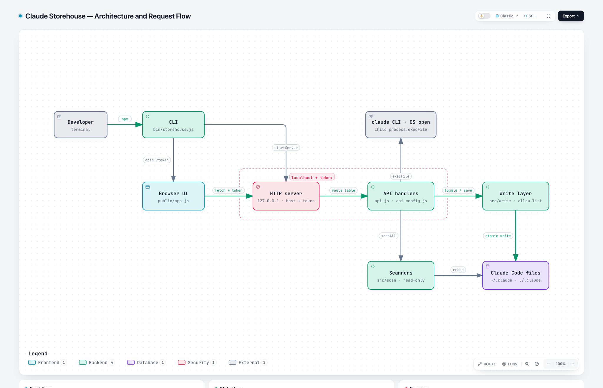

# Architecture

Snapshot at commit `74d6585`.

## Request flow

1. The developer runs `npx claude-storehouse`.
2. The CLI (`bin/storehouse.js`) makes a random token and starts the HTTP server on `127.0.0.1`.
3. The CLI opens the browser at `/?token=<token>`. The UI (`public/api.js`) moves the token to `sessionStorage`.
4. The UI sends each `/api` request with the `x-storehouse-token` header.
5. The server (`src/server.js`) checks the Host header and the token, then finds the handler in its route table.
6. The handler (`src/api.js`, `src/api-config.js`) sends reads to the scanners and changes to the write layer.
7. Only the write layer (`src/write/`) writes files. It backs up each file, then saves it in one safe step.

## Parts

| Part              | Files                                      | Job                                                                                                   |
| ----------------- | ------------------------------------------ | ----------------------------------------------------------------------------------------------------- |
| CLI               | `bin/storehouse.js`                        | Reads flags, finds the home and project folders, starts the server, opens the browser                 |
| Browser UI        | `public/`                                  | Shows the pages and calls the API with the token                                                      |
| HTTP server       | `src/server.js`                            | Binds `127.0.0.1`, checks Host and token, limits the body to 2 MB, serves `public/` with CSP          |
| API handlers      | `src/api.js`, `src/api-config.js`          | One handler per route. Records each change in the in-memory activity log for undo                     |
| Scanners          | `src/scan/`                                | Read-only. `scanAll` builds the inventory. `scanUsage` reads token counts from session `.jsonl` files |
| Write layer       | `src/write/`                               | Toggles, file edits, favorites, delete to trash, backups, path allow-list                             |
| External          | `claude` CLI, `open` / `xdg-open`          | Plugin uninstall and "open in editor or Finder" through `execFile`                                    |
| Claude Code files | `~/.claude`, `~/.claude.json`, `./.claude` | The config that the app reads and writes, plus `backups/storehouse` and its `trash`                   |

## Read flow

- `GET /api/inventory` runs `scanAll`. It scans settings, plugins, skills, agents, MCP servers, CLAUDE.md, hooks, and favorites.
- When one section fails, `scanAll` adds an error and uses a fallback value. It does not stop.
- `GET /api/usage` reads only token counts from session transcripts.

## Write flow

- `toggle()` scans the inventory again, then calls the handler for the item kind.
- `mutateJson` reads the file, changes it, and tries one more time when the file changed on disk.
- Each write copies a backup (the last 20 are kept), writes a `.tmp` file, then renames it.
- Delete moves the file to `~/.claude/backups/storehouse/trash`.

## Security

- The server binds `127.0.0.1` and accepts only its own Host header.
- Each `/api` call needs `x-storehouse-token`. The server compares it with `timingSafeEqual`.
- `isAllowed` limits writes to `~/.claude`, `~/.claude.json`, and the project folder. The plugin cache is read-only.
